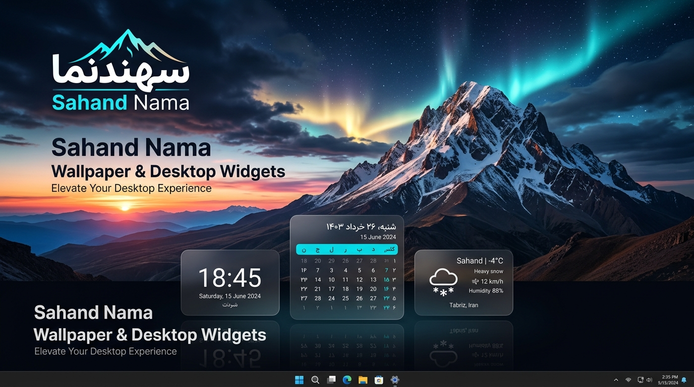

<div align="center">

<p align="center">
  
</p>

# 🖼️ Sahand Nama | BingWallpaperPro (v1.8.2)

<p align="center">
  <b>Comprehensive Enterprise Windows Wallpaper & Lock Screen Automation Platform with Frosted Glass Desktop Widget, Weather Telemetry & Self-Healing Diagnostics</b>
  <br />
  <i>Designed & developed by Sahand Electronic Solutions Co. (<a href="https://irres.ir">irres.ir</a>)</i>
</p>

<p align="center">
  <a href="README.fa.md"><b>🇮🇷 مطالعه به زبان فارسی (Persian)</b></a> •
  <a href="#-direct-downloads"><b>Downloads</b></a> •
  <a href="#-features"><b>Features</b></a> •
  <a href="#-architecture"><b>Architecture</b></a> •
  <a href="#-quick-start"><b>Quick Start</b></a>
</p>

<p align="center">
  <a href="https://github.com/taimazus/SetWinWallpaper/releases/latest">
    
  </a>
  
  
  
  
</p>

</div>

---

## 📥 Direct Downloads

You can run Sahand Nama out of the box with zero runtime dependencies (bundled self-contained .NET runtime):

| Package Type | GitHub Direct Download Link | Size | Recommended For |
| :--- | :--- | :---: | :--- |
| 🚀 **Standalone Executable (EXE)** | [**Download SahandNama-v1.8.2-win-x64.exe**](https://github.com/taimazus/SetWinWallpaper/releases/download/v1.8.2/SahandNama-v1.8.2-win-x64.exe) | ~140 MB | 1-Click instant launch without installation |
| 📦 **Portable ZIP Archive** | [**Download SahandNama-v1.8.2-win-x64.zip**](https://github.com/taimazus/SetWinWallpaper/releases/download/v1.8.2/SahandNama-v1.8.2-win-x64.zip) | ~61 MB | Complete bundle with PowerShell automation scripts & docs |
| 🏷️ **All Releases** | [**View GitHub Releases**](https://github.com/taimazus/SetWinWallpaper/releases) | — | Full changelog & release history |

---

## 🌟 Overview

**Sahand Nama** (formerly BingWallpaperPro) is an enterprise-grade Windows desktop customization suite. It automatically retrieves ultra-high-definition wallpapers (up to 4K / 3840px) from global photography and space archives, manages lock screens and Windows Spotlight, renders an elegant acrylic/frosted-glass widget with live weather, and provides 1-click self-healing repair routines for broken Windows Spotlight setups.

```mermaid
graph LR
    subgraph Sources ["Curated Global Image Sources"]
        B["Bing & Bing Global"]
        IR["Iran Beautiful Landscapes"]
        W4K["Wallhaven 4K Archives"]
        ART["Chicago Art Institute & Open Media"]
        GEO["Wildlife & Geographic Archives"]
        N["NASA Image of the Day"]
        H["ESA / Hubble & James Webb"]
    end
    
    subgraph Engine ["Sahand Nama Central Hub"]
        Core["High-Speed Caching, Color Palette & GPU Renderer"]
    end
    
    subgraph Outputs ["Features & System Integration"]
        D["Multi-Monitor Desktop Sync"]
        L["Lock Screen & Spotlight"]
        WID["Frosted Glass Desktop Widget"]
        CLR["Dynamic Windows Accent Sync"]
        HK["Global Hotkeys (Win+Alt+W)"]
        TRY["Silent System Tray Integration"]
    end

    Sources --> Core --> Outputs
```



---

## ✨ Features

- 🛰️ **Multi-Source 4K Fetching**: Automatic rotation across Bing, NASA, Wallhaven, USGS, and national heritage photography.
- 🖥️ **Multi-Monitor Awareness**: Distinct or synchronized wallpaper management across multi-display workstations.
- 🪟 **Frosted Glass Acrylic Widget**: Live clock, Persian & Gregorian calendar, dynamic weather telemetry, and hardware metrics.
- 🎨 **Adaptive Accent Color Sync**: Automatically synchronizes the Windows accent color with the dominant color palette of the current wallpaper.
- 🛠️ **Windows Spotlight Self-Healing**: Diagnoses and automatically resets corrupted Windows Spotlight assets and registry configurations.
- ⚡ **Zero-Overhead Native Performance**: Built in high-performance C# with low CPU/RAM footprint.

---

## 🚀 Quick Start (Development & Building)

### Prerequisites
- [.NET 8.0 SDK](https://dotnet.microsoft.com/download) or later
- Visual Studio 2022 or VS Code with C# Dev Kit

### Build from Source
```bash
git clone https://github.com/taimazus/SetWinWallpaper.git
cd SetWinWallpaper
dotnet restore
dotnet build -c Release
```

### Run Tests
```bash
dotnet test
```

---

## 📄 License

Distributed under the **MIT License**. See [`LICENSE`](LICENSE) for terms.

---

<div align="center">
  <sub>Developed by <a href="https://irres.ir">Sahand Electronic Solutions Co.</a> • Maintainer <a href="https://github.com/taimazus">Taimaz</a></sub>
</div>
